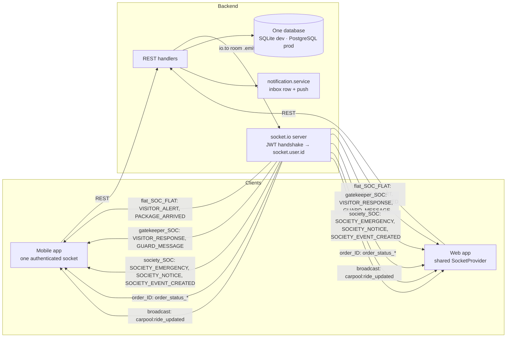

# LocalSampark — Investor Readiness Report

**Date:** 2026-10-09 (second pass; the first pass, 2026-09-19, follows from §1)
**Scope:** `apps/web`, `apps/admin`, `apps/mobile`, `backend`
**Companion documents:** [`PARITY_AUDIT.md`](PARITY_AUDIT.md) (feature parity matrix), [`DESIGN_AUDIT.md`](DESIGN_AUDIT.md) (UI/UX audit)

---

## 0. Second pass — 2026-10-09

The first pass left two items open: the mobile society module was static (§5.3), and mobile screens other than order tracking did not subscribe to real-time events (§5.2). Both are closed. Re-running the demo personas through every pillar against a live server then found more defects. Each one below was reproduced before it was fixed and verified after.

### 0.1 Defects that would have stopped the demo

| # | Defect | Effect on the demo | Fix |
|---|---|---|---|
| 1 | **The society API had 8 routes, and the web society page and mobile tabs call far more.** Members, bills, polls, amenities, complaints, parking, events, directory, the guard inbox, visitor approve/decline and the emergency board all answered 404 on web, and mobile never called them. | Every society tab except the gate log was empty or broken, on both platforms | 56 new routes (64 total): 53 handlers in a new `society-resident.controller.js` plus visitor approve/decline/check-in on the existing state machine, each behind the existing per-society capability guards. Pinned by a contract test that reads both clients' source and fails on any call without a route |
| 2 | **14 of 16 mobile society tabs were placeholders or fabricated.** Five said "Feature coming soon". Parking showed a Honda City and a Royal Enfield as every resident's vehicles. Polls showed invented vote counts, and "Vote" only displayed an alert. SOS displayed "Security is on the way" and sent nothing. Pre-approvals lived in component state with a fixed PIN. Bills read fields the API does not return, so every bill showed ₹0 / Unpaid | A resident would have seen invented data, or an SOS that summoned nobody | All 16 tabs rebuilt on one shared kit (`src/components/society/SocietyKit.js`): real endpoints, loading/error/empty states, 44pt targets, themed. The society role now comes from the server's membership, not the platform role |
| 3 | **The workspace packages resolved to another copy of the repo.** `node_modules/@localsampark/*` linked to `localsampark 22-09-2026`. The backend, web and admin all loaded `@localsampark/shared` from that stale snapshot | The territory geofencing suite could not load (`territoryTopology` absent there), and edits to `packages/` were invisible to the apps | Links repointed to this checkout |
| 4 | **The dev database was 15+ migrations behind the code.** `orders.rider_payout` (migration 122) was missing | Order placement and every rider endpoint 500'd: `no such column: rider_payout` | `npm run db:migrate` (after a backup). It is now step 2 of §6 |
| 5 | **The demo rider was not a rider.** Every delivery route requires an approved `delivery_agents` row; the seeder never created one | The rider dashboard answered 403 `NOT_A_RIDER` on every call | Seeded, KYC approved, online in Dhanori |
| 6 | **No demo shop appeared under any category.** `/shops/nearby` filters on `category_id`; demo shops set only a free-text category | Tap "Grocery" and the seeded supermarket was missing | The seeder resolves `category_id` from `shop_categories` |
| 7 | **The job board showed none of the seeded jobs.** The board reads `local_job_postings`; the seeder wrote two other tables | The job seeker saw two leftover "Smoke Job" rows | Seeded into the board table. Applying now refuses duplicates (409) and records `applied_at` |
| 8 | **Gate visitor alerts were never stored.** `visitor_alert` is not a type the notifications table's CHECK constraint accepts, so the insert failed | With push unconfigured, a resident received nothing when a visitor arrived | Unlisted types are stored as `system`, with the real type kept in `data.type` |
| 9 | **SOS raised from the society board reached no one live.** It broadcast to a `society_<id>` room that no handler ever joined | The guard saw it only after a refresh | `join_society_room` added (members only) |
| 10 | **Every mobile persona button signed in as the consumer.** The switcher passed role names its phone map does not contain | "Merchant" opened the shop dashboard as a shopper | Rebuilt with eight real personas (§0.4) |

### 0.2 Other defects fixed

- **Notice board leak:** `GET /societies/notices?societyId=…` read any society's notices for any signed-in account. It is now members-only and verified live (403).
- **Web gate entry always 400'd.** The web form sends `visitorName` / `flatNumber`, while the handler read `name` / `flat`. Both spellings are now accepted.
- **Guard parcel queue was always empty.** It filtered `status = 'received'`, while parcels are stored as `'pending'`.
- **Web notices posted to a route that doesn't exist** (`/society-management/notices`). The contract test caught it.
- **Web society actions:** 23 buttons flashed "✅" without checking the response, and a refusal (a second vote, an overlapping booking) became an unhandled promise rejection. Writes now return `{success:false, error}`, and the buttons show the server's reason.
- **Web staff attendance grid** expected `{attendance, allStaff}` from an endpoint that returns an array.
- **Mobile `/modules/carpool`** showed seat *capacity*, so the count never dropped as people booked.
- **SOS sent the Gateway of India.** `sos/index.js` reported 18.922, 72.834 and pincode 400001 from every phone. It now sends the device's fix, falls back to the last-known one, and otherwise sends no coordinates rather than false ones.
- **Mumbai pincode 400001 was hardcoded** in delivery jobs, lost-and-found (including posting), scrap pickups, the blood-bank and medical donor forms, and town-square tips. All now use the user's resolved territory pincode.
- Keyboard handling in the society module: `KeyboardAvoidingView`, `keyboardShouldPersistTaps`. Tab chips and back button raised to 44pt.

### 0.3 Status by pillar

"Verified live" means exercised against a running server as the seeded personas, not inspected.

| Pillar | Status | Evidence |
|---|---|---|
| **3. Society security & gate** | ✅ Verified live | 82-check API probe across four personas: every read, every write, every double-action conflict, every permission refusal. 13-check socket probe: walk-in → resident `VISITOR_ALERT` in 38 ms; resident approves → guard `VISITOR_RESPONSE` in 19 ms; SOS → guard in 17 ms; notice → residents live; non-members refused every room. Pinned by `integration/societyResidentSurface.test.js` (38) and `societyClientContract.test.js` (5) |
| **6. Delivery & dispatch** | ✅ Rider and customer reads verified live | The rider sees the in-flight order and one ready for pickup; the customer sees their history. The full lifecycle is covered by the existing `integration/orderLifecycle.test.js` and was not re-driven by hand in this pass |
| **5. Carpool** | ✅ Verified live | Booking returns remaining seats; another client's socket receives `carpool:ride_updated` in 39 ms, and web and mobile patch the ride in place |
| **4. Jobs** | ✅ Board and apply verified live; employer live updates server-side only | 10 seeded postings across Retail, Logistics, Security, Facilities and Administration, with 30 applicants in four stages. The server emits `jobs:application_received`, but **no client subscribes yet** |
| **1. Shops & categories** | ✅ Category browsing verified live | All 15 demo shops appear under their category in `/shops/nearby` |
| **2. Geofencing & territory** | ✅ Tests pass; not re-audited by hand | `territoryTopology` (26) now runs at all (see 0.1 #3); `geofenceMonitor` and `territoryResolution` pass |

### 0.4 Demo data and personas

`npm run seed:demo --workspace=backend` now writes **419 rows**, identical on re-run, with zero failed inserts and **17/17 checks** passing. Re-seeding also clears what a rehearsal leaves on demo records: orders at demo shops, seat bookings, job applications and votes.

| Dataset | Seeded |
|---|---:|
| Shops, each in a real `shop_categories` category | 15 |
| Catalogue items | 138 |
| Job postings on the board / applicants in 4 stages | 10 / 30 |
| Carpool rides, partly booked | 7 |
| Orders: pending, confirmed, preparing, ready (OTP 4826), out for delivery (rider assigned, OTP 4822), delivered | 6 |
| Society members (6 personas + 16 neighbours + 4 guards) | 26 |
| Guards on today's roster across two gates / gate passes / today's gate register | 5 / 10 / 8 |
| Bills (paid, pending, overdue) / events with RSVPs / polls with votes | 22 / 3 / 2 |

Gate passes use codes **482101–482110**. One visitor, *Santosh Patil → B-401*, is left **pending**, so the resident persona can approve them live on stage.

**Persona switcher** (development builds of both apps): tap **👤 Personas**. Eight personas on mobile (Consumer, Resident, Committee, Gate guard, Merchant, Rider, Commuter, Job seeker); the same plus Service pro and Admin on web. Each signs in through the real OTP flow and opens that persona's screen.

### 0.5 Real-time data flow



Every room join is authorised on the server against society membership or order ownership. A client cannot listen to a flat, gate or society it does not belong to; this was probed live with a non-member persona.

### 0.6 Verification (this pass)

| Suite | Result |
|---|---|
| Backend unit + integration | **1267 passed, 97/97 suites** (was 1198 with one suite unable to load) |
| Mobile jest | **211 passed, 10/10 suites** |
| Web production build | **Compiles, no warnings** |
| Admin production build | **Compiles, no warnings** |
| Changed mobile files: Babel (app preset) + ESLint (project config) | All compile; 0 lint errors |
| Live society API probe / live socket probe / live carpool socket probe | 82/82 · 13/13 · 1/1 |
| Seeder, run twice | 419 rows both times, 17/17 checks |

### 0.7 Still open

- **No device run.** The Android app was verified by compiling every changed file with the app's Babel preset, linting, and the jest suite, not on a phone or emulator. Run it on a device before the pitch.
- **Jobs live updates:** the server emits them; no client listens yet.
- **Migration 107** (`society_members` without a flat) cannot drop its old table on the dev database because of foreign keys. It has failed this way since before this pass; a `society_members_rebuilt` table is left over. Nothing reads it.
- **Demo-shop photos** are the same two stock images for every shop; one product image is shared across all items.
- **Dead code:** `apps/mobile/src/screens/carpool/FindRide.js` is imported nowhere and asserts a 4.9 rating for every ride.
- Phases from the brief not started: the consumer shop gaps listed in §5.4 and a per-screen Android back-button audit.

---

## 1. The three defects that would have ended the demo

Each was found by running the system, not by reading it, and each is fixed and verified.

### 1.1 None of the twelve demo logins worked

`/auth/verify-otp` short-circuits the `+9190000000NN` numbers and **synthesised** a user object with an id like `mock-user-1789749865283` that it never persisted. `auth.middleware.js` then ran:

```js
queryOne('SELECT * FROM users WHERE id = $1', [decoded.userId])
```

…found nothing, and returned `401 User not found.` A persona could sign in and then call **nothing**. Probed against a running server, all twelve were rejected by every authenticated route.

**Fixed.** The demo branch now resolves the seeded row through the same query layer the middleware reads, and falls back to the synthesised object only when the database has not been seeded — logging a warning that names the seed command when it does.

Measured before and after, all twelve personas:

| | before | after |
|---|---|---|
| token subject | `mock-user-<timestamp>` | `demo-user-NN` |
| `GET /users/me` | `401` | `200` |

### 1.2 `/users/me` queried a different database than the one that authenticated the request

`config/prisma.js` builds a real `PrismaClient` **even when `USE_SQLITE=true`**, and Prisma's datasource is `DATABASE_URL` — a Supabase PostgreSQL instance. So in the local and demo configuration the middleware authenticated against SQLite and the handler then queried Supabase. Observed, on every call:

```
FATAL: (ENOIDENTIFIER) no tenant identifier provided (external_id or sni_hostname required)
→ 500
```

`/users/me` is the first call both clients make after login, so this single split broke the opening screen of the web app and the Android app.

**Fixed.** `GET` and `PUT /users/me` now use `config/database`, matching the rest of the file, which already did. A `presentUser()` mapper serves both the snake_case row and the camelCase keys Prisma used, so no client breaks on the change.

**All thirteen other Prisma modules have since been migrated too — see §5.1.** There is no Prisma left in the application code.

### 1.3 Deployed to Vercel, every API call from both web apps 404s

| Target | `NEXT_PUBLIC_API_URL` | `api.js` computed | Result |
|---|---|---|---|
| Render | `RENDER_EXTERNAL_URL` (a bare origin) | `+ /api/v1` | correct |
| Vercel | `https://…onrender.com/api/v1` | `+ /api/v1` | `/api/v1/api/v1/…` → **404 on everything** |
| Mobile | its own constant, already includes `/api/v1` | used as-is | correct |

Three consumers held three different conventions for one variable.

**Fixed.** Both `apps/web/src/lib/api.js` and `apps/admin/src/lib/api.js` strip a trailing `/api/v{n}` and any trailing slash before appending the version segment, so either form resolves to the same base. Five input shapes are covered by a test.

---

## 2. Demo seeding

`backend/src/seeds/seed-investor-demo.js` — new, idempotent, and self-verifying.

```bash
npm run seed:demo --workspace=backend          # seed
npm run seed:demo:verify --workspace=backend   # check without writing
```

Run twice back to back: **205 rows both times, zero failed inserts, all nine checks green.** Idempotency is by construction — every row carries a deterministic `demo-` id and the run tears its own rows down first, children before parents.

| Dataset | Seeded |
|---|---:|
| Demo personas (real `users` rows) | 12 |
| Shops, one per live category | 7 |
| Catalogue items, priced with MRP and stock | 70 |
| Job postings (`job_vacancies` + `admin_jobs`) | 10 + 10 |
| Applicants across Applied → Screening → Interview → Offered | 30 |
| Properties (1/2/3 BHK, commercial, rent and sale) | 8 |
| Carpool routes with real coordinates and seat pricing | 5 |
| Orders across the delivery lifecycle, with line items | 4 |
| Society: members, bills, complaints, amenities, notices, polls, packages, parking, staff, pre-approved visitors | 6/6/4/4/3/1/4/6/4/3 |

Three things the seeder does that matter for a live demo:

- **Bills are a mix of paid and pending**, and complaints span open / in-progress / resolved, so no screen is uniformly green.
- **Shop hours vary by category** — the pharmacy is 24×7, the farm store opens at 06:00 — because the urgent-intent path filters on "open now", and a catalogue that all closes at 21:00 goes empty after 21:00.
- **It reports what it could not write** rather than swallowing it. That is how five schema mismatches were found (`job_applications.job_id` points at `job_vacancies`, not `admin_jobs`; `society_parking_slots.assigned_to` at `society_members`, not `users`; `carpool_rides` requires WKT coordinates; `society_members` is unique per user; `society_complaint_activity` holds an FK onto complaints, so the teardown order mattered).

### Demo personas

OTP is always `123456`. The short-circuit is gated to non-production — a test asserts it stays that way, because an ungated fixed OTP on `+919000000012` is an unauthenticated path to a super-admin token.

| Phone | Role | Name |
|---|---|---|
| +919000000001 | user | Sunita Bhosale |
| +919000000002 | resident_member | Abhijeet Kulkarni |
| +919000000003 | society_admin | Meera Joshi |
| +919000000004 | security_guard | Ramesh Yadav |
| +919000000005 | shop_owner | Vikas Sharma |
| +919000000006 | service_provider | Imran Shaikh |
| +919000000007 | delivery_agent | Rohan Patil |
| +919000000008 | field_agent | Kiran More |
| +919000000009 | area_agent | Snehal Pawar |
| +919000000010 | territory_admin | Sunil Deshmukh |
| +919000000011 | moderator | Anjali Nair |
| +919000000012 | super_admin | Platform Admin |

---

## 3. Other defects found and fixed

| # | Defect | Evidence |
|---|---|---|
| 1 | **20 of the 23 endpoints the web `/society` page calls return 404.** The page was written against an API surface never implemented on `/society-management`; the features live on sibling routers (`/society-billing`, `/societies`, `/society-compliance`, `/society-analytics`, `/society-forum`). | Probed with a real `society_admin` token |
| 2 | The society page's `api()` helper swallowed non-2xx responses, so a 404 parsed into `{error}` and collapsed to `[]` — a missing route looked exactly like an empty list | code read |
| 3 | The notices tab read `localStorage['token']` while every other call on the page reads `'auth_token'`, so it was unauthenticated even when signed in | code read |
| 4 | `GET /society-management/staff/attendance/today` returned 500 on every call: `TO_CHAR` is PostgreSQL-only and SQLite has no such function | server log |
| 5 | `apps/mobile/app/config` and `app/components` sat inside the Expo Router tree, making `config/api.js` addressable as a route, and `LanguageToggle` existed twice | failing test, 43 assertions |
| 6 | **Every socket authorisation check refused every legitimate user.** The handshake assigned the decoded JWT verbatim to `socket.user`, but the payload names the subject `userId` while every handler reads `socket.user.id` — so the society flat room, the gatekeeper room and the `VISITOR_RESPONSE` relay all compared `undefined` against a real id | live socket probe: a seeded resident was refused their own flat |
| 7 | **No `join_order_room` handler existed at all.** `orderSocket.js` and `trackingSocket.js` broadcast every update to `order_<id>`; nothing ever joined those rooms, so live order tracking could not work for any client on any platform | route table read, then confirmed live |
| 8 | `SocketProvider`, `ConfigProvider` and `ToastProvider` were imported into the web `layout.js` and never rendered. `ToastProvider` mounts react-hot-toast's `<Toaster>`, so all **33 files calling `toast()` were writing to a surface that did not exist** — every success and error notification in the web app was silent | import-vs-JSX diff |

**Fixes.** The society helper now recognises sibling router prefixes and resolves them absolutely, and throws on non-2xx so a failed tab renders the error state added in the UI pass rather than an empty table. The notices call goes through the helper. `TO_CHAR` is replaced with a bound parameter (portable and index-friendly) — `500 → 200`. The two mobile directories were moved to `src/`, 34 importers rewritten and verified to resolve, and the duplicate `LanguageToggle` deleted.

---

## 4. Verification

Everything below was executed, not inspected.

| Suite | Result |
|---|---|
| `backend` unit + integration (`npm run test:unit`) | **901 passed, 55/55 suites** |
| `apps/mobile` jest | **211 passed, 10/10 suites** |
| `apps/web` production build | **300 routes, clean** |
| `apps/admin` production build | **clean** |
| Theme regression (`tests/e2e/web/theme.spec.js`) | **6 passed** |
| Touch targets (`tests/e2e/accessibility/touch-targets.spec.js`) | **5 passed** — 0% under 44px on all four routes |
| Pre-existing a11y suite | **22 passed** (was 4 failing) |
| Demo personas + API base (`backend/src/__tests__/demo-personas.test.js`) | **11 passed**, new |
| Socket handshake + order rooms (`backend/src/__tests__/socketAuth.test.js`) | **5 passed**, new |
| No-Prisma guard (`backend/src/__tests__/noPrismaSplitBrain.test.js`) | **4 passed**, new |
| Auth flows under `USE_SQLITE` (live probe) | **13 passed** |
| Migrated endpoints under `USE_SQLITE` (live probe) | **12 passed** |
| Seeder idempotency | **205 rows, identical on re-run, zero failed inserts, 9/9 checks** |

Both backend suites that were failing before this work now pass. `categoryRouterParity` was fixed by the directory move; `mlRanker` passes in isolation and in the full run — it had been failing only as a cross-suite state leak.

New regression guards added this pass: theme (6), touch targets (5), mobile design tokens (35), demo personas and API base (11), socket handshake and order rooms (5), and the no-Prisma guard (4).

---

## 5. Status of the two items previously left open, and what remains

Stated plainly, because a demo is not the place to discover these.

### 5.1 The second database is gone — resolved

This was the largest remaining risk. It is closed: **there is no Prisma left in the application code.**

`config/prisma.js` built a `PrismaClient` even under `USE_SQLITE=true` — `getSharedPrisma()` falls back to `new PrismaClient()` when the guarded factory returns null — pointed at `DATABASE_URL`. Worse than a second datasource, its schema modelled tables this database does not have: `Shop` is `@@map`ped to `shops`, `Product` to `products`, `Appointment` to `appointments`, and `ServiceSlot` / `DeliveryRoute` / `Tenant` to tables no migration creates at all. **Eleven of the nineteen mapped tables are absent.** The real ones are `local_shops`, `shop_products` and `shop_appointments`.

All 41 call sites across 13 modules now use `config/database`:

| Module | Calls | What it reads now |
|---|---:|---|
| `core/routes/auth.routes.js` | 19 | `users`, `regions`, `wallets`, `email_verification_tokens`, `password_reset_tokens`, `local_shops` |
| `ecommerce/routes/cart.routes.js` | 6 | `cart_items` joined to `shop_products` and `local_shops` |
| `crm/controllers/admin-revenue.controller.js` | 5 | `regions`, `users`, `orders` |
| `crm/controllers/admin-krishi.controller.js` | 4 | `admin_krishi_listings` |
| `ecommerce/routes/shop.routes.js` | 3 | `shop_services`, `shop_appointments` |
| `core/services/upload.service.js` | 3 | `file_uploads` |
| `services/routes/tracking.routes.js` | 1 | `orders` |
| `services/controllers/delivery.controller.js` | 1 | `orders` |
| `crm/controllers/admin-health.controller.js` | 1 | `admin_audit_log` |
| `middleware/auth.middleware.js` | — | engine branch removed |
| `tenant/tenant-module.controller.js` | — | calls were already commented out; no `tenants` table exists |

Three defects surfaced during the migration and were fixed with it:

- **`/tracking/:orderId` answered 404 for every order ever placed**, because `delivery_routes` does not exist. It also nudged the coordinates by `(Math.random() - 0.5) * 0.001` "for realism" — the same invented movement the mobile tracker drew. It now reads `orders`, and is **authorised**: the route was authenticated but not authorised, so any signed-in user could track any order, delivery address included.
- **P2P parcel requests could not be stored at all.** `delivery.controller.js` wrote `orders` in paise columns (`subtotalPaise`, `totalAmountPaise`) that do not exist, plus a nested `deliveryRoute`. It now writes `orders`, with a CSPRNG delivery OTP.
- **Appointment booking wrote a table that does not exist.** The double-booking guard cited migration 106, whose unique index is on `shop_appointments` — so the index was never protecting the code path in use. Now it is, with the constraint violation translated into the same 409 the pre-check returns.

Verified under `USE_SQLITE=true`, where every one of these used to 500: **13 auth-flow assertions and 12 endpoint assertions pass**, covering OTP registration, refresh, email registration, single-use verification (including replay refusal), login, wrong-password rejection, forgot/reset password with old-password invalidation, cart add/over-stock/remove, tracking for customer and rider, and the admin dashboard, krishi and analytics reads.

Pinned by `backend/src/__tests__/noPrismaSplitBrain.test.js`, which fails if anything imports the client, calls `prisma.<model>.<method>()`, branches auth on the engine, or queries the three phantom table names.

### 5.2 Real-time — transport built, web fully consolidated, mobile screens partly subscribed

This was the section that said nothing worked. The transport layer now does:

| | before | after |
|---|---|---|
| `socket.user.id` from a `userId` token | `undefined` | resolved |
| resident joins own flat room | refused | **joined** |
| guard joins gatekeeper room | refused | **joined** |
| non-member joins a flat room | refused | refused |
| customer / rider / shop owner join order room | *no handler existed* | **joined** |
| unrelated user or anonymous joins order room | *no handler existed* | refused |
| web `SocketProvider` mounted | no | yes |
| mobile socket connection | none | one authenticated connection |
| mobile order tracking | `Math.random()` | real `order_status_*` events |

All verified against a live server and pinned by `backend/src/__tests__/socketAuth.test.js`, which runs a real socket.io server in-process.

**The nine ad-hoc web connections are now consolidated.** They had drifted in ways that mattered: **five sent no auth token**, and because the handshake degrades an unrecognised connection to a guest rather than refusing, those pages connected and were then refused every authorised room with nothing to explain it. Only one stripped `/api/v1` from the URL, which socket.io needs as a bare origin.

Four screens moved to hooks (`tracking`, `resident`, `gatekeeper`, `shop-dashboard`); five kept their effect bodies and take the shared connection through `getSharedSocket()`, so working code was not rewritten for no gain. Their `disconnect()` calls became listener removals — closing a shared socket on one screen's unmount would drop realtime everywhere else.

Two more defects fell out of that work:

- **`/resident` joined `flat_SOC-123_A-402`** — a hardcoded society and flat. Every resident on the platform listened to the same fake room, so nobody received their own visitor alerts. It now resolves the real membership from the server, and `join_flat_room` verifies it.
- **`/gatekeeper` POSTed visitors to an authenticated route with no `Authorization` header**, and joined the gate room with `{ gateId: 'GATE-1' }` and no society — which the server requires, since the gate id alone is not unique and every deployment's first gate is called GATE-1. Both fixed; the room is joined once on mount rather than per submit.

**What remains:** *(second pass)* the gate console, society notices, packages, messages, SOS and events now subscribe; see §0.5. Shop orders were not revisited. The transport, the hooks and the authorisation are in place and tested.

### 5.3 Mobile society module is still largely static — *resolved in the second pass, see §0*

Eleven of sixteen society tabs make no API call; five are `"Feature coming soon..."` placeholders. `VisitorsTab` holds pre-approvals in React state and never sends them, so a resident can pre-approve a visitor and the guard will not see it — the seeder now creates three real pre-approvals so the gate console has something to check against, but the mobile write path is still local-only.

### 5.4 Not started from the brief

Phase 4 in full (Zod/Yup schema validation across forms, offline retry queues, image fallbacks, React 18/19 hook modernisation), the consumer shop gaps (reviews, Q&A, offers, global search), carpool OTP verification on mobile, and the mobile society tabs in §5.3.

---

## 6. Running the demo

```bash
# 1. Bring the schema up to date (idempotent; back up backend/src/data/localsampark.db first).
#    Skipping this is what made checkout and the rider screens 500 — see §0.1 #4.
USE_SQLITE=true npm run migrate --workspace=backend

# 2. Seed (re-run before the pitch to clear a rehearsal)
USE_SQLITE=true npm run seed:demo --workspace=backend

# 3. Backend (SQLite — see §5.1 before choosing this)
USE_SQLITE=true NODE_ENV=development PORT=5000 node backend/src/server.js

# 4. Apps
npm run dev:web     # localhost:3000
npm run dev:admin   # localhost:3001

# 5. Tap 👤 Personas (bottom right) or sign in with any persona from §2, OTP 123456
```

The web app takes over a minute to compile its first route on a cold `next dev`. Warm it before anyone is watching.

One operational note: **do not run `npm run build:web` while a dev server is serving the same directory.** Both write `apps/web/.next`, and the build replaces chunks the running server still references — the dev server then serves pages with no CSS at all (`Cannot find module './9479.js'`). It cost an hour of chasing phantom test failures during this work.
