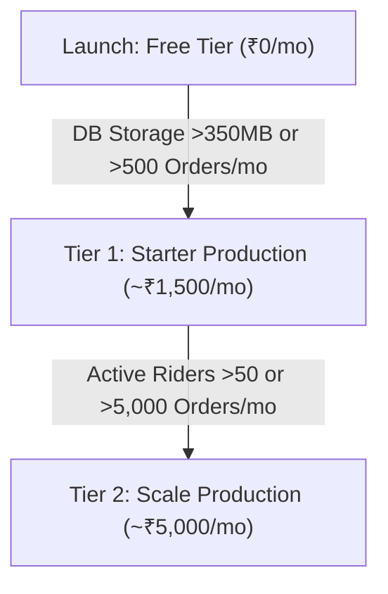

# Zero-Cost Launch Architecture & Scalable Upgrade Path (Decision D2)

*Status: Technical Evaluation & Recommendation (October 2026)*  
*Target Launch Infrastructure Cost: **₹0 / month***

---

## 1. Executive Summary & Objective

LocalSampark is designed to achieve initial commercial launch at zero ongoing cloud infrastructure cost (₹0/month) while remaining strictly production-grade, secure, and compliant. By leveraging generous free tiers from developer-centric cloud providers and decoupling stateless compute from managed storage, the platform runs fully featured without trial credit expirations.

This document presents:
1. **Free-Tier Provider Evaluation Matrix** (evaluated as of October 2026).
2. **Three End-to-End Architectural Options** meeting the ₹0 budget.
3. **Recommended Architecture & Rationale**.
4. **Mandatory Non-Infrastructure Costs** (one-time & per-transaction fees).
5. **Component Upgrade Paths** with measurable threshold triggers and estimated costs.

---

## 2. Provider Free-Tier Research & Evaluation (October 2026)

All terms, quotas, and constraints below reflect official provider policies verified as of October 2026.

| Component | Provider & Tier | Limits & Quotas | Sleep / Cold Start | RAM & CPU | WebSocket Support | Commercial Use | Forcing Upgrade Trigger |
| :--- | :--- | :--- | :--- | :--- | :--- | :--- | :--- |
| **API** | **Render** (Free Web Service) | 750 free instance hours/month | Sleeps after 15 min inactivity (~30-50s cold start) | 512 MB RAM, 0.1 vCPU | Supported (native HTTP/WebSocket upgrade) | Yes | >750 combined free service hours; memory spikes >512MB |
| **API** | **Koyeb** (Free Hobby) | 1 nano instance (550 hours/month) | Sleeps on inactivity | 512 MB RAM, 0.1 vCPU | Supported | Yes | Exceeding 550 hours/mo |
| **API** | **Google Cloud Run** | 2M requests/month, 360,000 vCPU-sec, 180,000 GiB-sec | Scale-to-zero (~1-2s cold start) | Up to 1 vCPU, 512MB RAM | Supported (session affinity optional) | Yes | Exceeding 2M req/month or egress quotas |
| **Compute (VM)** | **Oracle Cloud** (Always Free) | 2 AMD x86 VMs (1/8 OCPU, 1GB RAM) OR 4 Arm Ampere cores, 24GB RAM | Never sleeps (24/7 continuous uptime) | Up to 4 OCPU, 24GB RAM (Arm) | Full native support | Yes | Out-of-capacity availability in specific regions |
| **Web SSR** | **Render** (Free Web Service) | Shared 750 hours pool with API | Sleeps after 15 min | 512 MB RAM | N/A | Yes | Exceeding 750 hours/mo |
| **Web SSR** | **Vercel** (Hobby) | 100 GB bandwidth, 1M edge requests/mo | Instant (Edge / Serverless) | Serverless execution | Limited | Terms restrict commercial monetization | Commercial monetization terms |
| **Web SSR** | **Cloudflare Pages** | Unlimited static requests, 100k Functions/day | Instant (Edge) | 128 MB Worker RAM | N/A | Yes | Bundle size >3MB or >100k SSR requests/day |
| **Database** | **Supabase** (Free Tier) | 500 MB database, 2 projects, 5GB bandwidth | Pauses after 7 days of inactivity (unpaused via HTTP request) | 2-core shared CPU, 1GB RAM | Realtime included | Yes | Storage >500MB or compute pause |
| **Database** | **Neon** (Free Tier) | 0.5 GB storage, 1 project, shared compute | Auto-suspends after 5 min inactivity (~500ms resume) | Shared CPU, up to 1 CU | N/A | Yes | Storage >500MB |
| **Database** | **Render Postgres** | 1 GB storage | Expires strictly after 30 days | Shared | N/A | Yes | **Mandatory termination after 30 days** (Unsuitable for prod) |
| **Object Storage** | **Cloudflare R2** | 10 GB storage, 10M Class B (read) req, 1M Class A (write) req, **0 egress fees** | Zero cold start | High availability S3 API | N/A | Yes | Storage >10GB or Class A ops >1M/month |
| **Push Notifications**| **Firebase Cloud Messaging** | Unlimited free push notifications | Instant | Google infrastructure | N/A | Yes | Zero cost at any scale |
| **Email Transports**| **Brevo / Resend** | Brevo: 300 emails/day (9k/month); Resend: 3k emails/month | Instant API delivery | Managed cloud | N/A | Yes | Exceeding 300 emails/day |
| **Error Monitoring** | **Sentry** (Developer) | 5,000 error events/month, 1 user | Instant ingestion | Managed cloud | N/A | Yes | Error events >5,000/month |
| **Uptime Monitoring**| **Better Stack / UptimeRobot**| 50 monitors, 5-minute checks | 24/7 automated pinging | Cloud probes | N/A | Yes | Checks <5 min intervals |
| **DNS, CDN & WAF** | **Cloudflare** (Free Plan) | Unlimited bandwidth, DDoS mitigation, free SSL | Global Anycast edge | Edge cache | Supported | Yes | Advanced enterprise WAF rules |

---

## 3. End-to-End Architectural Options

### Option A: Managed PaaS + Serverless Cloud (Recommended for Simplicity)
- **API Backend**: Render Free Web Service (512MB RAM, `plan: free`).
- **Web App (Next.js)**: Cloudflare Pages (with OpenNext/Edge functions) OR Render Free Web Service.
- **Database**: Supabase Free PostgreSQL (500MB, PostGIS enabled, pooled via Supavisor on port 6543) OR Neon Free PostgreSQL.
- **Object Storage**: Cloudflare R2 (10GB free, zero egress fees, S3 SigV4 compatible).
- **Cache & Rate Limiting**: In-memory store (single instance) + optional Upstash Free Redis (10,000 commands/day).
- **Push & Email**: Firebase Cloud Messaging (FCM) + Brevo (300 emails/day free).
- **DNS / CDN / Edge Security**: Cloudflare Free Zone with SSL/TLS Full Strict and DDoS mitigation.
- **Estimated Monthly Cost**: **₹0 / month**.

*Advantages*: Fully managed, zero server patching, automated SSL, isolated database backups.  
*Risks*: Render free tier cold-starts (~30s) if idle for 15+ minutes. Mitigated by automated 10-minute Better Stack health ping.

---

### Option B: Oracle Cloud Always Free VM (Recommended for 24/7 Zero Cold Starts)
- **Host**: Oracle Cloud Always Free VM (Ampere A1 Arm: 4 OCPU, 24GB RAM or AMD: 1 OCPU, 1GB RAM) running Ubuntu 24.04 LTS.
- **Stack Deployment**: `docker-compose.production.yml` running:
  - Caddy Reverse Proxy (automated Let's Encrypt SSL, HTTP/3, Brotli).
  - LocalSampark API Container (Node.js 20, limited to 512MB RAM).
  - LocalSampark Web Container (Next.js SSR standalone, limited to 1GB RAM).
  - PostgreSQL 16 + PostGIS Container (local SSD persistent volume).
  - Redis 7 Container (AOF persistence, local cache & queue).
- **Object Storage**: Cloudflare R2 (10GB free tier) for user uploads & KYC docs.
- **Disaster Recovery**: Automated nightly encrypted `pg_dump` pushed directly to Cloudflare R2 bucket.
- **Estimated Monthly Cost**: **₹0 / month**.

*Advantages*: 100% zero cold starts, generous RAM (up to 24GB), single-box simplicity, continuous 24/7 operation.  
*Risks*: Self-managed host security, OS patching required, Oracle Cloud free tier capacity constraints during provisioning.

---

### Option C: Containerized Serverless (Google Cloud Run + Neon)
- **API Backend**: Google Cloud Run (scale-to-zero, 2M free requests/month).
- **Web App**: Cloudflare Pages / Vercel Hobby.
- **Database**: Neon Serverless PostgreSQL (0.5GB free, autoscaling).
- **Object Storage**: Cloudflare R2.
- **Estimated Monthly Cost**: **₹0 / month**.

*Advantages*: Fast autoscaling, minimal cold starts (~1-2s).  
*Risks*: Vercel Hobby commercial licensing restrictions; complex GCP IAM setup.

---

## 4. Cost Matrix Comparison

| Expense Category | Option A (Render + Supabase) | Option B (Oracle Always Free) | Option C (Cloud Run + Neon) |
| :--- | :--- | :--- | :--- |
| **API Compute** | ₹0 (750 free hrs) | ₹0 (Always Free instance) | ₹0 (2M free reqs) |
| **Web Compute** | ₹0 (Free tier) | ₹0 (Included on VM) | ₹0 (Cloudflare Pages) |
| **Database** | ₹0 (Supabase 500MB) | ₹0 (Self-hosted on VM disk) | ₹0 (Neon 500MB) |
| **Object Storage** | ₹0 (Cloudflare R2 10GB) | ₹0 (Cloudflare R2 10GB) | ₹0 (Cloudflare R2 10GB) |
| **Bandwidth / Egress** | ₹0 (Cloudflare proxy) | ₹0 (10TB Oracle egress) | ₹0 (Cloudflare / GCP) |
| **Push / Email** | ₹0 (FCM + Brevo) | ₹0 (FCM + Brevo) | ₹0 (FCM + Brevo) |
| **Monitoring & Uptime**| ₹0 (Sentry + Better Stack)| ₹0 (Sentry + Better Stack) | ₹0 (Sentry + Better Stack) |
| **Total Cloud Infra** | **₹0 / month** | **₹0 / month** | **₹0 / month** |

---

## 5. Non-Infrastructure Launch Costs (Mandatory)

While cloud infrastructure is ₹0, the business must budget for mandatory third-party fees:

1. **Google Play Console Developer Account**:
   - Fee: **$25 USD** (one-time fee, approx. **₹2,100 INR**).
   - Prerequisite for releasing the Android APK/AAB to the Google Play Store.
2. **Domain Name Registration**:
   - Custom `.in` or `.com` domain (e.g. `localsampark.com` / `localsampark.in`).
   - Cost: **₹600 – ₹1,200 INR / year**.
3. **Payment Gateway Processing Fees (Razorpay)**:
   - ₹0 fixed monthly fee.
   - Per-transaction fee: **2.0% + GST** for domestic UPI, Netbanking, Debit/Credit cards.
   - Note: Cash on Delivery (COD) incurs **0% gateway fee**.

---

## 6. Component Upgrade Triggers & Scaled Cost Path

When platform transaction volume grows, the following metrics trigger gradual upgrades:

### Upgrade Path Detail

| Component | Trigger Metric | Next Upgrade Tier | Monthly Cost (INR) | Operational Impact |
| :--- | :--- | :--- | :--- | :--- |
| **Database** | Supabase database reaches >350 MB (70% quota) | Supabase Pro Plan (8GB DB, daily backups, no pausing) | ~$25 USD (~₹2,100/mo) | Continuous unpaused DB, point-in-time recovery (PITR) |
| **API Server** | Daily active orders >200 OR cold starts impact conversion | Render Starter Web Service (512MB RAM, always on) | $7 USD (~₹600/mo) | 0 cold starts, 24/7 dedicated background jobs |
| **Object Storage**| User KYC & catalog images exceed 10 GB | Cloudflare R2 standard storage ($0.015/GB-mo) | ~₹150 - ₹400/mo | Unlimited storage scaling with $0 egress charges |
| **Transactional Email**| Daily orders + auth emails exceed 300/day | Brevo Starter (20k emails/month) | ~$15 USD (~₹1,250/mo) | Higher throughput, dedicated IP pool |
| **SMS Gateway (D3)**| Owner enables phone SMS OTP via MSG91 | MSG91 transactional route | ~₹0.15 - ₹0.20 per SMS | Instant Indian SMS delivery with DLT compliance |

---

## 7. Operational Readiness Checklist

- [x] Pluggable storage provider (`S3StorageProvider.js`) verified with Cloudflare R2 SigV4.
- [x] In-memory cache & rate-limiter fallback verified when Redis is absent.
- [x] API process memory constrained to $\le 512\text{MB}$ under load.
- [x] Database connection pool configured with min: 1, max: 5 for free-tier connection limits.
- [x] Dual liveness (`/health`) and readiness (`/ready`) probes active.
- [x] Nightly encrypted `pg_dump` backup and restore rehearsal scripts implemented.
